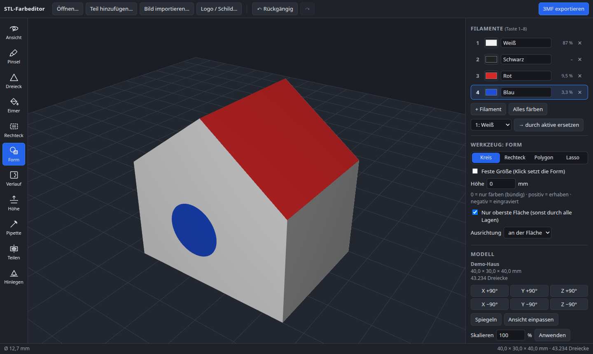
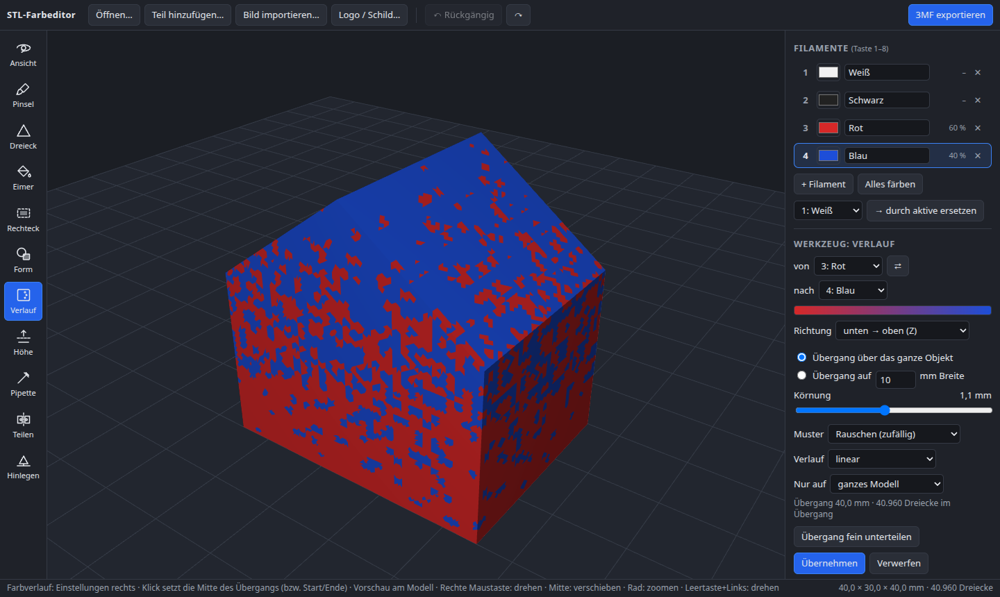
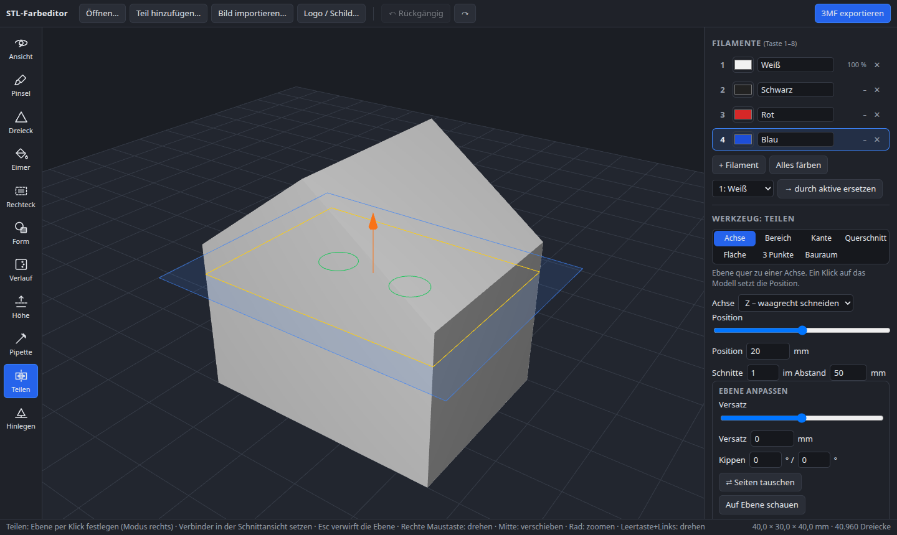
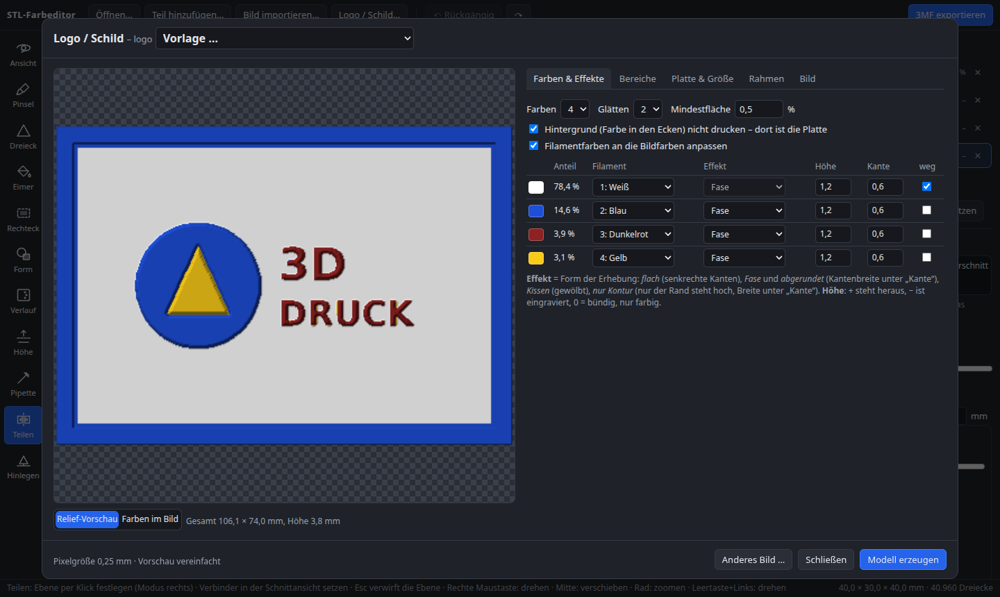
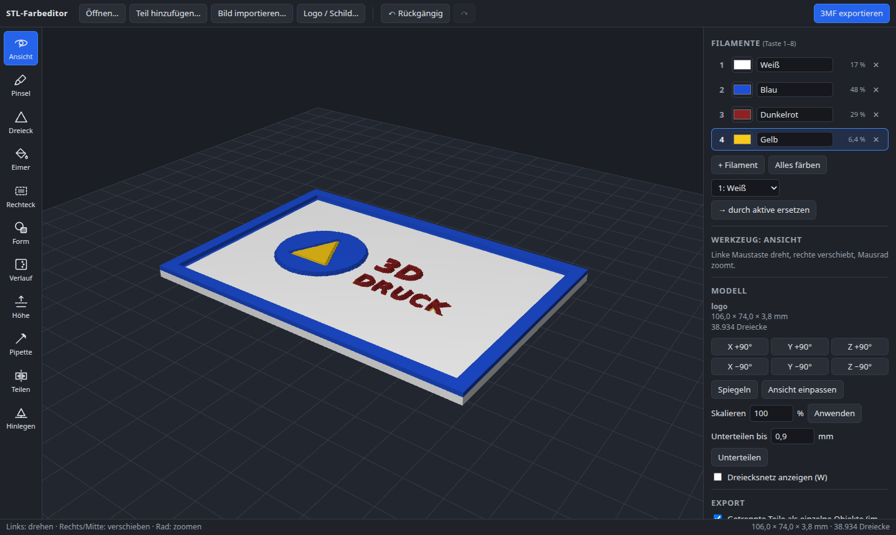

# 3D-Druck-Tool – STL-Farbeditor


Fertige 3D-Modelle (STL/OBJ/3MF) **mehrfarbig bemalen**, Logos in **druckfertige Schilder**
verwandeln und große Modelle **in druckbare Teile zerlegen** – direkt im Browser, komplett
offline, ohne Installation. Exportiert wird ein 3MF für den **Anycubic Slicer Next** (ACE Pro);
das Format lesen auch OrcaSlicer, Bambu Studio und PrusaSlicer.



## Funktionen auf einen Blick

| | |
|---|---|
|  |  |
| **Farbverlauf** zwischen zwei Filamenten – als Raster, Rauschen oder Streifen | **Teilen** in druckbare Teile, mit Dübeln, Zapfen, Magnet-Bohrungen oder Nut & Feder |
|  |  |
| **Logo / Schild-Editor** mit Relief-Vorschau, Effekten, Plattenformen und Rahmen | … ergibt ein fertiges, mehrfarbiges Schild als 3D-Modell |

- **Malwerkzeuge:** Pinsel, Dreieck, Eimer, Rechteck, Höhe, Pipette, exakte Formen (Kreis, Rechteck, Polygon, Lasso) – bündig, erhaben oder eingraviert
- **Bilder** als farbige Platte erzeugen oder exakt auf die Modelloberfläche aufbringen
- **Bis zu 8 Filamente**, Rückgängig/Wiederholen, Drehen, Spiegeln, Skalieren, Hinlegen, Unterteilen
- **3MF-Export** mit Farbe pro Dreieck; exportierte Dateien lassen sich wieder öffnen

## Download

Neueste Version unter [Releases](https://github.com/tmoedl/3D-Druck-Tool/releases) herunterladen
oder klonen:

```bash
git clone https://github.com/tmoedl/3D-Druck-Tool.git
cd 3D-Druck-Tool
```

Voraussetzung ist nur ein aktueller Browser mit WebGL2 (Chrome, Edge, Firefox). Unter
Linux/macOS wird Python 3 für den lokalen Webserver genutzt; unter Windows geht es auch ohne.

## Starten

**Linux / macOS:**

```bash
./start.sh
```

**Windows:** `start.bat` doppelklicken (oder in der Konsole `start.bat`). Ist Python
installiert, wird es benutzt; sonst startet ein eingebauter PowerShell-Webserver –
es muss also nichts installiert werden. Anderer Port: `start.bat -Port 8766`.

Beides öffnet `http://localhost:8765` im Browser. Ein lokaler Server ist nötig, weil
Browser JavaScript-Module nicht direkt von der Festplatte laden. Alles läuft
offline; three.js liegt in `vendor/`.

## Bedienung

| Maus / Taste | Funktion |
|---|---|
| Rechte Maustaste | Modell drehen |
| Mittlere Maustaste | verschieben |
| Mausrad | zoomen |
| Leertaste + Links | drehen (in jedem Werkzeug) |
| 1–8 | Filament wählen |
| Strg + Malen | mit Filament 1 malen (Radierer) |
| Alt + Klick | Farbe aufnehmen |
| Strg+Z / Strg+Y | Rückgängig / Wiederholen |
| `[` `]` | Pinsel kleiner / größer (beim Bild-Platzieren: Bildgröße) |
| `,` `.` | Bild beim Platzieren drehen |
| Enter / Rücktaste / Esc | Polygon schließen / Punkt entfernen / abbrechen |
| G | Farbverlauf |
| W | Dreiecksnetz anzeigen |
| Pos1 | Ansicht einpassen |

**Werkzeuge**

- **Pinsel (B):** färbt zusammenhängende Dreiecke im Radius, also nicht durch dünne Wände hindurch.
- **Dreieck (T):** färbt einzelne Dreiecke.
- **Eimer (F):** füllt eine Fläche, bis eine Kante kommt (Kantenwinkel einstellbar). Beim Darüberfahren erscheint eine Vorschau. Mit 180° wird das ganze zusammenhängende Teil gefärbt.
- **Rechteck (R):** färbt alles im aufgezogenen Rechteck, wahlweise nur die sichtbaren Flächen.
- **Form (K), exakt und unabhängig von den Dreiecken:** Kreis, Rechteck, Polygon oder Lasso. Das Netz wird genau entlang der Kontur geschnitten und bleibt geschlossen. Mit *Feste Größe* setzt ein Klick z. B. einen Kreis mit genau 10 mm Ø. *Höhe* 0 färbt nur (bündig), ein positiver Wert macht die Form erhaben, ein negativer graviert sie ein. Die Form wird an der angeklickten Fläche ausgerichtet oder wahlweise in Blickrichtung projiziert.
- **Höhe (H):** färbt alles ober- oder unterhalb der Klickhöhe (Shift kehrt um).
- **Verlauf (G):** Farbverlauf zwischen zwei Filamenten über das geladene Modell, siehe unten.
- **Pipette (I)** und **Hinlegen (L):** Hinlegen legt das Modell mit der angeklickten Fläche aufs Bett.
- Außerdem: **Alles färben**, **Farbe ersetzen**, Drehen um 90°, Spiegeln, Skalieren.

**Feine Details:** Bemalt wird pro Dreieck. Große, flache Dreiecke (typisch bei
CAD-Exporten) lassen sich deshalb nur als Ganzes färben. Abhilfe schafft
*Modell → Unterteilen bis X mm*, das lange Kanten halbiert, ohne die Form zu ändern.

## Bild importieren

**Bild anpassen:** drehen, spiegeln, Helligkeit, Kontrast, Sättigung.

**Farben:**
- *Automatisch:* 2–8 Farben, ausgewählt nach dem größten Flächenanteil.
- *Nur vorhandene Filamente:* Du hakst die Filamente an, die verwendet werden sollen, und jedes Pixel bekommt die ähnlichste davon.

Einzelne abweichende Pixel und Rauschen werden ignoriert: Dafür sorgen *Glätten* (ein Mehrheitsfilter) und die *Mindestfläche*. Mit *Hintergrund weglassen* wird die Farbe in den Bildecken automatisch ausgeschnitten.

Pro Farbe lassen sich Filament, Höhe und *weglassen* einstellen.

**Ausgabe:**
- **Neues Modell (Platte/Schild):** Breite und Höhe sind gekoppelt. Einstellbar sind außerdem Dicke, Pixelgröße, das Filament der Grundplatte und ein Rahmen (Breite, Filament, Höhe).
- **Auf das geladene Modell aufbringen:** Nach *Platzieren …* folgt eine Bildvorschau der Maus auf der Oberfläche; ein Klick setzt das Bild. Das Platzieren bleibt danach aktiv: Jeder weitere Klick setzt dasselbe Bild noch einmal, erst **Fertig** (oder Esc) beendet es. Auch nach dem Öffnen eines anderen Modells bleibt das Bild an der Maus. Danach setzt **Letztes Bild platzieren** (oben in der Leiste) das zuletzt benutzte Bild jederzeit wieder an. Das Bild wird exakt in die Oberfläche eingeschnitten und steht nicht ab. Mit Höhe > 0 wird eine Farbe erhaben, z. B. ein Logo mit transparentem Hintergrund, mit Höhe < 0 wird sie eingraviert. Transparente und weggelassene Bereiche bleiben unverändert. Standardmäßig werden dafür Filamente gewählt, die das Modell noch nicht benutzt.

## Farbverlauf (Werkzeug „Verlauf“, Taste G)

Färbt das Modell mit einem Übergang zwischen zwei Filamenten. Die Vorschau erscheint
sofort am Modell; erst **Übernehmen** macht ihn fest (Strg+Z macht ihn rückgängig).

- **von / nach:** die beiden Filamente (⇄ tauscht sie).
- **Richtung:** entlang X, Y oder Z (beide Richtungen), quer über den Bildschirm
  (aus der aktuellen Ansicht) oder **2 Punkte auf dem Modell** (Klick 1 = Start, Klick 2 = Ende).
- **Übergang:** über das ganze Objekt oder auf eine feste Breite (z. B. 10 mm).
  Die Mitte lässt sich per Regler oder per Klick auf das Modell setzen.
- **Körnung:** Größe der Farbpunkte bzw. Streifen (0,1–20 mm). Klein = feiner, genauer Übergang.
- **Muster:** *Raster* (gleichmäßig), *Rauschen* (zufällig, natürlicher) oder *Streifen*
  quer zum Verlauf (wirkt bei Z-Verläufen wie Farbwechsel nach Schichten).
- **Verlauf:** linear, weich (S-Kurve), schnell oder langsam beginnend.
- **Nur auf:** wahlweise nur Flächen eines bestimmten Filaments umfärben.
- **Übergang fein unterteilen:** Bemalt wird pro Dreieck. Für feine Körnungen werden
  die Dreiecke **nur im Übergangsbereich** auf Körnungsgröße unterteilt; der Rest des
  Modells bleibt unverändert. Ein Hinweis erscheint, wenn das Netz zu grob ist.

## Logo / Schild

*Logo / Schild…* (oder im Bild-Dialog *Logo / Schild-Editor…*) erzeugt aus einem Logo
ein druckfertiges, mehrfarbiges Schild mit 3D-Effekten. Links ist eine Relief-Vorschau
mit Licht und Schatten, rechts sind die Einstellungen. **Vorlagen** setzen sinnvolle
Startwerte (klassisches Schild, modern mit Schattenfuge, Kontur/Magnet, nur Logo,
Gravur, Medaillon, Sechseck, eingekerbte Ecken); danach bleibt alles einstellbar.

- **Farben & Effekte:** Die Farben werden an den Häufigkeitsspitzen gewählt. So bleiben
  reine Logofarben erhalten, statt in Mischtönen der Kantenglättung zu verschwimmen.
  Pro Farbe gibt es Filament, **Effekt** (flach, Fase, abgerundet, Kissen/gewölbt,
  nur Kontur), **Höhe** (+ erhaben, − eingraviert, 0 bündig) und Kantenbreite.
  Der Hintergrund wird automatisch weggelassen; dort liegt die Platte.
- **Bereiche:** Rechtecke ins Bild zeichnen, die den Effekt überschreiben – z. B. nur
  die Schrift 1,5 mm erhaben und abgerundet, das Logo gewölbt. Sie gelten für alle
  oder nur für eine Farbe und können ein eigenes Filament haben.
- **Platte & Größe:** Logo-Breite, Pixelgröße (Feinheit), Form *Rechteck* (Ecken eckig,
  abgerundet, abgeschrägt oder eingekerbt), *Kreis*, *Oval*, *Sechseck* oder **Kontur**,
  die sich dem Inhalt anpasst (Abstand, Glättung, Löcher füllen). Dazu Dicke, Filament,
  Inhalt durchgehend farbig, eine Zierlinie innen und Aufhängelöcher.
- **Rahmen:** flach, modern mit Schattenfuge, doppelt, Fase innen/außen, Rundstab,
  Hohlkehle, Stufen, mit Rille, klassischer Bilderrahmen – mit Breite, Höhe und Filament.
  Der Rahmen folgt immer der Plattenform, auch der Kontur.
- **Bild:** drehen, spiegeln, Helligkeit, Kontrast, Sättigung.

Das erzeugte Netz ist geschlossen und mannigfaltig. Gleich hohe Flächen werden
zusammengefasst, damit die Dreieckszahl klein bleibt. Die Einstellungen bleiben
erhalten: *Logo / Schild…* öffnet sie erneut.

## Teilen (Werkzeug „Teilen“, Taste S)

Zerlegt ein Modell in druckbare Teile. Jede Schnittfläche wird geschlossen, die Teile
passen exakt aufeinander. Die Farben bleiben erhalten.

**Ebene finden** (Modus oben im Werkzeug):
- **Achse:** quer zu X, Y oder Z an einer Position (Regler, Zahl oder Klick aufs Modell).
  Optional mehrere parallele Schnitte im festen Abstand.
- **Bereich:** Klick wählt eine glatte Fläche bis zu ihren Kanten aus (z. B. den Schaft eines
  Stabes). Shift+Klick fügt weitere Flächen hinzu, Strg+Klick nimmt welche weg. Jede Grenze der
  Auswahl wird als mögliche Schnittlinie aufgelistet, auch wenn sie schräg oder geschwungen
  verläuft (z. B. die Unterkante gewickelter Blätter). Schnittform:
  *folgt genau der Grenze*: Die Schnittfläche ist glatt gewölbt, die Fuge liegt genau unter
  der Kante, beide Teile bekommen dieselbe Fläche. Oder *eben, knapp innerhalb / außerhalb der
  Auswahl / mittig*, mit einstellbarem Abstand zur Grenze. Richtung automatisch (quer zur Grenze),
  Z-Achse oder Blickrichtung. Auf gewölbten Schnitten gehen Dübel, Zapfen, Magnete und Bohrungen;
  Nut & Feder nur bei ebenen Schnitten.
- **Kante:** Mit der Maus über eine Kante fahren, der erkannte Kantenzug leuchtet. Ein Klick
  legt die Ebene genau durch diese Kante, z. B. einen kleinen Absatz oder Knick in einer
  geschwungenen Form. Liegt der Kantenzug nicht ganz eben, werden Punkte bis zur Abweichung
  auf die Ebene gezogen („Fangen“). Liegt eine Absatzfläche genau in der Ebene, wird sie dem
  richtigen Teil zugeordnet.
- **Querschnitt:** Klick auf die Oberfläche, und die Ebene läuft quer zur Form mit dem kleinsten
  Querschnitt (gut für Arme, Rohre, Bögen).
- **Fläche:** parallel zur angeklickten Fläche, mit *Versatz* ins Modell hinein.
- **3 Punkte:** durch drei angeklickte Punkte.
- **Bauraum:** automatisch so viele Schnitte, dass jedes Teil in den Bauraum (Standard
  250 × 250 × 250 mm, minus Rand) passt, wahlweise an schmalen Stellen.

Feinjustage: Versatz, Kippen, Seiten tauschen (der orange Pfeil zeigt zu Teil 2),
*nur an der angeklickten Stelle* (z. B. nur einen Arm) oder *ganze Ebene*.

**Verbindungen** (alle Maße einstellbar):
- **Bohrungen + Dübel:** Löcher in beiden Teilen, dazu separat gedruckte Dübel (Länge,
  Aufteilung, Spiel, Lochzugabe, Fasen; wahlweise liegend und abgeflacht gedruckt).
- **Zapfen fest an Teil 1 oder 2:** Zapfen mit Fase, passendes Loch mit Spiel im anderen Teil.
- **Magnet-Bohrungen:** Magnet-Ø und -Höhe, Spiel, Tiefenzugabe, in einem oder beiden Teilen.
- **Nur Bohrungen:** z. B. für Schrauben, Gewindeeinsätze oder Stifte.
- **Nut & Feder / Falz:** umlaufend in festem Abstand vom Rand, mit Spiel und Tiefenzugabe.
- Form *rund*, *sechseckig* oder *quadratisch* (verdrehsicher), Anzahl automatisch oder fest.

Die Verbinder werden automatisch verteilt und **in jeder Tiefe** auf die Mindestwand geprüft,
auch wenn das Modell hinter der Schnittfläche schmaler wird. In der Schnittansicht setzt ein
Klick einen Verbinder, Ziehen verschiebt ihn und ein Rechtsklick entfernt ihn. Grün heißt in
Ordnung, rot heißt Problem (der Grund steht im Tooltip). Ungültige Verbinder werden beim
Teilen weggelassen.

**Teile & Druck:** Liste mit Größe je Teil und Bauraum-Prüfung. *Hinlegen & anordnen* legt
jedes Teil auf seine größte ebene Fläche und verteilt alle auf dem Druckbett. *Teile als STL
(ZIP)* speichert jedes Teil einzeln. Beim 3MF-Export wird jedes Teil ein eigenes Objekt.

## Export

*3MF exportieren* (Strg+S) schreibt die Bemalung pro Dreieck. Filament *n* im
Editor entspricht Filament *n* im Slicer, der Slicer braucht also mindestens
so viele Filamente wie verwendet. Exportierte 3MF-Dateien lassen sich wieder
öffnen; Farben und Filamentnamen bleiben dabei erhalten.

## Dateien

- `index.html`, `style.css`: Oberfläche
- `js/main.js`: Ansicht, Werkzeuge, Dialoge
- `js/mesh.js`: Netz-Topologie, Pinsel, Füllen, Unterteilen
- `js/io.js`: STL/OBJ/3MF lesen, 3MF schreiben
- `js/image.js`: Farbreduktion, Bildanpassung, Platte aus Bild
- `js/cut.js`: exaktes Einschneiden von Konturen, erhaben/vertieft
- `js/logo.js`: Logo-Relief (Höhenfeld, Profile, Plattenformen, Rahmen, dichtes Netz)
- `js/logoui.js`: Dialog „Logo / Schild“
- `js/gradient.js`: Farbverlauf (Raster, Rauschen, Streifen)
- `js/split.js`: Teilen – ebener Schnitt mit Deckeln, Verbinder, Kantenzug, kleinster Querschnitt, Anordnen
- `js/splitui.js`: Werkzeug „Teilen“
- `start.sh` (Linux/macOS), `start.bat` + `start.ps1` (Windows), `server.py`: lokaler Webserver
- `vendor/`: three.js r170 (MIT)
- `docs/images/`: Screenshots für diese Beschreibung

## Versionen

Die aktuelle Version steht in der Datei [`VERSION`](VERSION) und oben links in der App
neben dem Namen. Änderungen je Version: [CHANGELOG.md](CHANGELOG.md).
Versionsnummern folgen [Semantic Versioning](https://semver.org/lang/de/) (`MAJOR.MINOR.PATCH`),
jede Version ist als Git-Tag `vX.Y.Z` markiert.

**Neue Version veröffentlichen:**
1. Nummer in `VERSION`, in `index.html` (`<span class="version">`) und im Badge oben in dieser README erhöhen.
2. Abschnitt in `CHANGELOG.md` ergänzen.
3. `git commit`, `git tag vX.Y.Z`, `git push --follow-tags`.

## Lizenz

[MIT](LICENSE). Enthält [three.js](https://threejs.org/) (MIT, © Three.js Authors).
